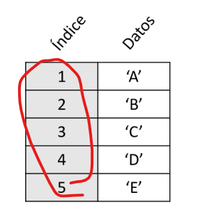
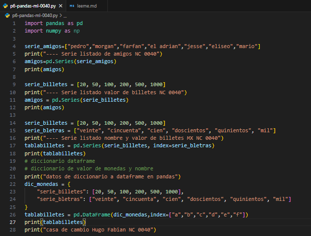
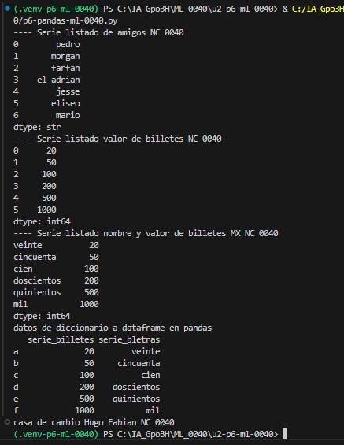

## ¿que es una serie?
índice: contiene valores únicos y, por lo general ordenados. Se usan para acceder a valores individuales de los datos.

vector: contiene los datos.

## El codigo

## EL resultado
